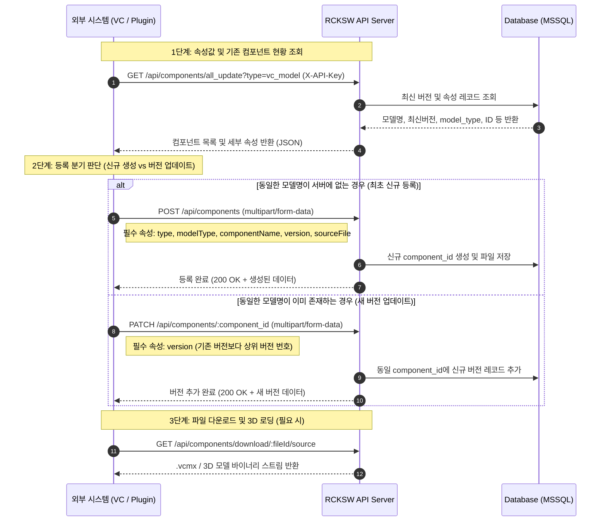

# 📘 RCKSW 외부 인터페이스 연동 API 명세서 (VC-Model 및 라이브러리)

본 문서는 외부 시스템(Visual Components 플러그인, C#/.NET Add-on, Python 스크립트, 3D/CAD 툴 등)에서 RCKSW 서버와 연동하여 **① 필요한 속성값 및 기존 등록 정보 조회(Select)**, **② 신규 컴포넌트 등록(Insert)**, **③ 버전 업데이트(Update)**, **④ 모델 파일 다운로드(Download)**를 수행하기 위한 종합 인터페이스 명세서입니다.

---

## 1. 연동 개요 및 공통 규격 (Overview & Common Specs)

- **Base URL**: `https://back.rck.dscloud.biz:8180` (운영 환경) / `http://localhost:8081` (로컬 개발)
- **인증 방식 (Authentication)**:
  - 모든 API 요청 시 HTTP Request Header에 발급받은 API 키를 전달합니다.
  - `X-API-Key: <발급받은_API_KEY>` (🟢 필수)
  - *(참고: API 키가 등록되어 있으면 DB uploader 항목에 `api-key:KEY_NAME`으로 자동 귀속됩니다.)*
- **표기 기준**:
  - 🟢 **[필수]**: 누락 시 `400 Bad Request` 에러 반환
  - 🟡 **[조건부 필수]**: 특정 조건(새 파일 미첨부 시 기존 파일 재사용 등)에 따라 필수
  - ⚪ **[선택]**: 전달하지 않아도 기본값 처리됨

---

## 2. 양방향 인터페이스 흐름 (Bidirectional Workflow)

외부 인터페이스 개발자가 **"서버에서 필요한 속성값을 조회하고, 외부 툴에서 작업 후 서버로 등록/업데이트"**하는 권장 시퀀스입니다.



---

## 3. 속성값 매핑 사전 (Property Data Dictionary)

외부 시스템과 서버가 주고받는 속성명 매핑표입니다. **조회할 때의 속성명(Response)**과 **등록/업데이트 시 전송할 속성명(Request Form-Data)**이 대응됩니다.

| 속성 분류 | 조회 속성명 (Response JSON) | 등록/수정 속성명 (Request Form-Data) | 데이터 타입 | 설명 및 유효값 | 필수 여부 |
| :--- | :--- | :--- | :---: | :--- | :---: |
| **고유 식별자** | `id` | - | Number | 특정 버전 파일의 고유 PK | 시스템 자동부여 |
| **그룹 식별자** | `component_id` | `:id` (URL Path) | Number | 여러 버전을 하나로 묶는 컴포넌트 대표 ID | 업데이트 시 필수 |
| **컴포넌트 명** | `file_name` | `componentName` | String | 컴포넌트/모델의 고유 명칭 (예: `Robot_Arm_A1`) | 🟢 [신규 필수] |
| **대분류 타입** | `type` | `type` | String | `"vc_model"`, `"vc_plugin"`, `"ns_model"`, `"ns_plugin"`, `"etc"` | 🟢 [신규 필수] |
| **모델 세부 분류** | `model_type` | `modelType` | String | **`"component"`** 또는 **`"layout"`** (`type='vc_model'` 필수) | 🟢 [VC_Model 필수] |
| **버전 정보** | `version` | `version` | String | 버전 문자열 (예: `1.0.0`, `1.1.0`) | 🟢 [필수] |
| **설명** | `description` | `description` | String | 모델/컴포넌트 상세 설명 텍스트 | ⚪ [선택] |
| **주요 기능** | `main_features` | `features` *(또는 `main_features`)* | Array / String | 주요 기능 목록 (배열 `["기능1", "기능2"]` 또는 개행 문자열) | ⚪ [선택] |
| **실행 환경** | `recommended_environment` | `environment` | String | 권장 동작 환경 (예: `Visual Components 4.8+`) | ⚪ [선택] |
| **메인 모델 파일** | `source_file_link`<br>`vcmx_file_link` | `sourceFile` | File | `.vcmx`, `.vcl`, `.fbx`, `.dll` 파일 | 🟢 [신규 필수]<br>🟡 [업데이트 조건부] |
| **썸네일 이미지** | `thumbnail_image` | `thumbnail` | File | `.png`, `.jpg` (미첨부 시 FBX에서 자동 3D 렌더링 생성) | ⚪ [선택] |
| **3D 프리뷰** | `fbx_file_link` | `fbxFile` | File | `.fbx` 3D 뷰어용 모델 파일 | ⚪ [선택] |
| **추가 첨부파일** | `additionalFiles` (목록) | `additionalFiles` | Files (배열) | 메뉴얼, 스펙 시트 등 다중 파일 (최대 20개) | ⚪ [선택] |
| **기존 파일 재사용** | - | `useExistingSource` | String | `"true"` 지정 시 파일 재업로드 없이 이전 소스 유지 | 🟡 [업데이트 시] |

---

## 4. API 상세 명세서 (API Endpoints)

### 4.1 [속성 조회] 최신 컴포넌트 목록 및 속성 조회 (Select Latest)

외부 시스템에서 현재 서버에 등록된 모델들의 전체 속성값(이름, 최신버전, ID, 분류 등)을 확인하여 중복 검사나 동기화를 수행할 때 호출합니다.

- **Method**: `GET`
- **Path**: `/api/components/all_update`
- **Query Parameters**:
  - `type` (선택): 조회할 타입 필터 (`vc_model`, `vc_plugin`, `ns_model`, `ns_plugin` 등. 미지정 시 전체)
- **Headers**:
  - `X-API-Key: <발급받은_API_KEY>` (🟢 필수)

#### 응답 예시 (`200 OK`)
```json
{
  "success": true,
  "message": "모든 파일 최신 버전 정보 조회 성공",
  "total_count": 2,
  "data": [
    {
      "id": 128,
      "component_id": 105,
      "file_name": "Robot_Arm_Kuka_KR16",
      "version": "1.2.0",
      "type": "vc_model",
      "model_type": "component",
      "description": "KUKA 6축 다관절 로봇 컴포넌트",
      "main_features": ["6축 회전 제어", "도달반경 1610mm", "VCMX 최적화"],
      "recommended_environment": "Visual Components 4.8+",
      "source_file_link": "/uploads/source/vc_model/vcmx/Robot_Arm_Kuka_KR16_1.2.0.vcmx",
      "vcmx_file_link": "/uploads/source/vc_model/vcmx/Robot_Arm_Kuka_KR16_1.2.0.vcmx",
      "fbx_file_link": "/uploads/source/vc_model/fbx/Robot_Arm_Kuka_KR16.fbx",
      "thumbnail_image": "/uploads/thumbnails/thumbnail-1725000000.png",
      "uploader": "api-key:external_vc_plugin",
      "download_count": 42,
      "created_at": "2026-08-15T09:00:00.000Z",
      "updated_at": "2026-09-10T11:20:00.000Z"
    }
  ]
}
```

---

### 4.2 [속성 조회] VC 전용 경량 동기화 목록 조회 (VC Lightweight Sync)

네트워크 부하를 최소화하면서 파일명, 버전, 모델타입, 다운로드 링크만 빠르게 가져오는 전용 API입니다.

- **Method**: `GET`
- **Path**: `/api/components/vc-sync`
- **Query Parameters**:
  - `type` (기본값: `"vc_model"`)
  - `model_type` (선택: `"component"` 또는 `"layout"`)
- **Headers**: `X-API-Key: <API_KEY>`

#### 응답 예시 (`200 OK`)
```json
{
  "success": true,
  "message": "Visual Components 동기화용 최신 버전 파일 정보 조회 성공",
  "total_count": 1,
  "data": [
    {
      "file_name": "Robot_Arm_Kuka_KR16",
      "version": "1.2.0",
      "model_type": "component",
      "category_id": null,
      "sub_category_id": null,
      "vcmx_file_link": "/uploads/source/vc_model/vcmx/Robot_Arm_Kuka_KR16_1.2.0.vcmx"
    }
  ]
}
```

---

### 4.3 [상세 조회] 특정 컴포넌트 상세 및 전체 버전 히스토리 조회

특정 컴포넌트의 과거 버전 목록(`relatedFiles`)과 추가 첨부파일 목록(`additionalFiles`)을 포함한 전체 정보를 조회합니다.

- **Method**: `GET`
- **Path**: `/api/components/:fileId`
- **Headers**: `X-API-Key: <API_KEY>`

---

### 4.4 [등록/업로드] 신규 컴포넌트 최초 등록 (Insert)

서버에 존재하지 않는 새로운 컴포넌트를 최초로 생성하여 등록할 때 호출합니다.

- **Method**: `POST`
- **Path**: `/api/components`
- **Content-Type**: `multipart/form-data`
- **Headers**: `X-API-Key: <API_KEY>` (🟢 필수)

#### Form-Data 파라미터 규격
| Field Name | Type | 필수 | 허용값 / 예시 | 설명 |
| :--- | :---: | :---: | :--- | :--- |
| `type` | Text | 🟢 | `"vc_model"` | 등록할 라이브러리 대분류 키 |
| `modelType` | Text | 🟢 | `"component"` 또는 `"layout"` | **VC Model일 경우 필수** |
| `componentName`| Text | 🟢 | `"Conveyor_Roller_500"` | 컴포넌트 명칭 |
| `version` | Text | 🟢 | `"1.0.0"` | 최초 등록 버전 번호 |
| `sourceFile` | File | 🟢 | `.vcmx`, `.vcl`, `.fbx`, `.dll` | 메인 3D 모델 또는 바이너리 파일 |
| `description` | Text | ⚪ | `"500mm 롤러 컨베이어 3D 모델"` | 컴포넌트 설명 |
| `features` | Text | ⚪ | `["속도 제어", "센서 연동"]` | 주요 기능 (JSON 배열 문자열 또는 줄바꿈 텍스트) |
| `environment` | Text | ⚪ | `"Visual Components 4.8+"` | 권장 실행 환경 |
| `thumbnail` | File | ⚪ | `thumb.png` (이미지) | 썸네일 (미첨부 시 FBX에서 자동 생성) |
| `fbxFile` | File | ⚪ | `model.fbx` (FBX) | 3D 웹 프리뷰 렌더링용 FBX 모델 파일 |
| `additionalFiles`| File[]| ⚪ | PDF, ZIP 등 (다중) | 보조 문서 및 첨부파일 |

#### 성공 응답 (`200 OK`)
```json
{
  "success": true,
  "message": "컴포넌트 등록 완료",
  "data": {
    "id": 135,
    "component_id": 135,
    "file_name": "Conveyor_Roller_500",
    "version": "1.0.0",
    "type": "vc_model",
    "model_type": "component",
    "source_file_link": "/uploads/source/vc_model/vcmx/Conveyor_Roller_500.vcmx",
    "thumbnail_image": "/uploads/thumbnails/auto-thumbnail-1725001122.png",
    "uploader": "api-key:external_vc_plugin"
  }
}
```

---

### 4.5 [버전 업데이트] 기존 컴포넌트 새 버전 등록 (Update / Version Up)

기존 컴포넌트에 상위 버전(예: `1.0.0` ➔ `1.1.0`)을 추가 생성하여 등록합니다.

- **Method**: `PATCH`
- **Path**: `/api/components/:id`
  - `:id` 자리에는 4.1 조회 API에서 확인한 대상 컴포넌트의 **`component_id`** (또는 이전 버전의 `id`)를 입력합니다.
- **Content-Type**: `multipart/form-data`
- **Headers**: `X-API-Key: <API_KEY>` (🟢 필수)

#### Form-Data 파라미터 규격
| Field Name | Type | 필수 | 허용값 / 예시 | 설명 |
| :--- | :---: | :---: | :--- | :--- |
| `version` | Text | 🟢 | `"1.1.0"` | **기존 버전과 겹치지 않는 새로운 상위 버전** |
| `sourceFile` | File | 🟡 | `Conveyor_Roller_v1.1.vcmx` | 새 버전 소스 파일 (파일 변경 시 첨부) |
| `useExistingSource`| Text| 🟡 | `"true"` 또는 `"false"` | 새 파일 첨부 없이 메타정보만 변경할 경우 `"true"` 지정 |
| `componentName`| Text | ⚪ | `"Conveyor_Roller_500"` | 이름 변경 시 지정 (이전 모든 버전 이름도 동기화) |
| `modelType` | Text | ⚪ | `"component"` 또는 `"layout"` | 분류 변경 시 지정 |
| `description` | Text | ⚪ | `"모터 파워 규격 업데이트"` | 새 버전에 대한 설명 |
| `features` | Text | ⚪ | `["고속 모드 추가"]` | 새 버전 주요 기능 |
| `environment` | Text | ⚪ | `"Visual Components 4.8+"` | 실행 환경 |
| `thumbnail` | File | ⚪ | `new_thumb.png` | 새 썸네일 이미지 |
| `fbxFile` | File | ⚪ | `model_v1.1.fbx` | 새 FBX 파일 |

#### 성공 응답 (`200 OK`)
```json
{
  "success": true,
  "message": "새 버전 생성 완료",
  "data": {
    "id": 136,
    "component_id": 135,
    "file_name": "Conveyor_Roller_500",
    "version": "1.1.0",
    "type": "vc_model",
    "model_type": "component",
    "source_file_link": "/uploads/source/vc_model/vcmx/Conveyor_Roller_v1.1.vcmx"
  }
}
```

---

### 4.6 [다운로드] 원본 파일 및 VCMX 다운로드

- **Method**: `GET`
- **Path**:
  - 메인 소스 파일 다운로드: `/api/components/download/:fileId/source`
  - VCMX 전용 다운로드: `/api/components/download/:fileId/vcmx`
  - 추가 첨부파일 다운로드: `/api/components/download/additional/:additionalFileId`
- **Headers**: `X-API-Key: <API_KEY>` (선택/권장)
- **Response**: 바이너리 파일 스트림 (`Content-Disposition: attachment; filename="..."`)

---

## 5. 언어별 연동 실전 예제 (Integration Code Examples)

외부 인터페이스 개발자가 바로 복사해서 연동 테스트할 수 있는 예제 코드입니다.

### 5.1 Python 연동 스크립트 (Visual Components 내장 Python 환경 추천)

```python
import os
import requests

BASE_URL = "https://back.rck.dscloud.biz:8180"
API_KEY = "YOUR_ISSUED_API_KEY"
HEADERS = {"X-API-Key": API_KEY}

def sync_and_upload(model_name, new_version, vcmx_path, model_type="component", description=""):
    # 1. 서버에서 기존 모델 및 속성 목록 조회
    query_url = f"{BASE_URL}/api/components/all_update?type=vc_model"
    res = requests.get(query_url, headers=HEADERS)
    res.raise_for_status()
    all_models = res.json().get("data", [])

    # 기존 모델이 존재하는지 확인
    existing_item = next((m for m in all_models if m["file_name"] == model_name), None)

    if existing_item:
        print(f"기존 모델 발견: ID {existing_item['component_id']}, 현재 최신버전 {existing_item['version']}")
        component_id = existing_item["component_id"]

        # 2-A. 기존 모델 버전 업데이트 (PATCH)
        update_url = f"{BASE_URL}/api/components/{component_id}"
        data = {
            "version": new_version,
            "description": description,
            "modelType": model_type,
            "features": '["버전 자동 업데이트"]'
        }
        with open(vcmx_path, "rb") as f:
            files = {"sourceFile": (os.path.basename(vcmx_path), f, "application/octet-stream")}
            resp = requests.patch(update_url, headers=HEADERS, data=data, files=files)
            print("업데이트 응답:", resp.status_code, resp.json())
    else:
        print(f"신규 모델 등록 시작: {model_name} (v{new_version})")

        # 2-B. 신규 모델 최초 등록 (POST)
        create_url = f"{BASE_URL}/api/components"
        data = {
            "type": "vc_model",
            "modelType": model_type,
            "componentName": model_name,
            "version": new_version,
            "description": description,
            "features": '["신규 생성 컴포넌트"]',
            "environment": "Visual Components 4.8+"
        }
        with open(vcmx_path, "rb") as f:
            files = {"sourceFile": (os.path.basename(vcmx_path), f, "application/octet-stream")}
            resp = requests.post(create_url, headers=HEADERS, data=data, files=files)
            print("신규 등록 응답:", resp.status_code, resp.json())

# 실행 예시
if __name__ == "__main__":
    sync_and_upload(
        model_name="Custom_Robot_Gripper",
        new_version="1.0.0",
        vcmx_path="./Custom_Robot_Gripper.vcmx",
        model_type="component",
        description="그리퍼 툴 컴포넌트"
    )
```

---

### 5.2 cURL CLI 테스트 예제

#### ① 속성 및 최신 목록 조회
```bash
curl -X GET "https://back.rck.dscloud.biz:8180/api/components/all_update?type=vc_model" \
  -H "X-API-Key: YOUR_API_KEY_HERE"
```

#### ② 신규 등록 (POST)
```bash
curl -X POST "https://back.rck.dscloud.biz:8180/api/components" \
  -H "X-API-Key: YOUR_API_KEY_HERE" \
  -F "type=vc_model" \
  -F "modelType=component" \
  -F "componentName=Custom_Robot_Gripper" \
  -F "version=1.0.0" \
  -F "description=그리퍼 툴 컴포넌트" \
  -F "features=[\"초고속 개폐\", \"에어 제어\"]" \
  -F "environment=Visual Components 4.8+" \
  -F "sourceFile=@./Custom_Robot_Gripper.vcmx"
```

#### ③ 버전 업데이트 (PATCH)
```bash
curl -X PATCH "https://back.rck.dscloud.biz:8180/api/components/135" \
  -H "X-API-Key: YOUR_API_KEY_HERE" \
  -F "version=1.1.0" \
  -F "description=파지력 보강 및 파라미터 개선" \
  -F "sourceFile=@./Custom_Robot_Gripper_v1.1.vcmx"
```

---

## 6. 에러 코드 및 예외 처리 (Error Handling)

| HTTP 상태 코드 | 에러 원인 | 에러 응답 예시 | 해결 방법 |
| :---: | :--- | :--- | :--- |
| **`400 Bad Request`** | VC Model에서 `modelType` 누락 | `{"success": false, "message": "VC Model의 타입(component 또는 layout)을 선택해주세요."}` | Form-Data에 `modelType="component"` 또는 `"layout"`을 전달 |
| **`400 Bad Request`** | 파일 크기 초과 (5GB 이상) | `{"success": false, "message": "파일 크기가 너무 큽니다. 최대 5120MB까지 업로드 가능합니다."}` | 파일 용량을 분할 압축하거나 확인 |
| **`400 Bad Request`** | 소스 파일 누락 | `{"success": false, "message": "소스 파일이 필요합니다."}` | `sourceFile` 첨부 또는 `useExistingSource="true"` 전달 |
| **`401 Unauthorized`**| API Key 누락 또는 유효하지 않음 | `{"success": false, "message": "API Key가 필요합니다. (X-API-Key 헤더)"}` | 요청 헤더에 정확한 `X-API-Key` 포함 |
| **`404 Not Found`** | 대상 `component_id` 없음 | `{"success": false, "message": "원본 컴포넌트를 찾을 수 없습니다."}` | `all_update` 조회 결과의 유효한 `component_id` 확인 |
